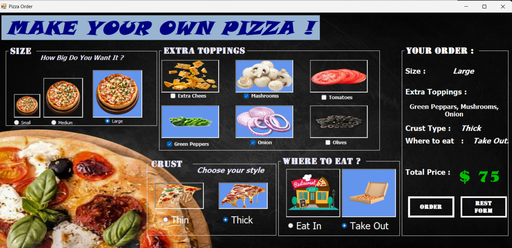

<div align="center">

# 🍕 Pizza Studio

**Build your own pizza and watch the order summary and price update live.**


</div>

---

## 📖 About

**Pizza Studio** is a Windows Forms desktop app built with **C# / .NET**.
Customers pick their size, crust, toppings and service type, and the app
instantly shows a live pizza preview, an order summary and the total price.

This project is part of **Course 14 (C# Level 1)** of
[Dr. Mohammed Abu-Hadhoud's](https://programmingadvices.com) programming roadmap.
I redesigned the interface with my own visual identity.

## 📸 Screenshot

<div align="center">



</div>

## ✨ Features

- 🍕 Choose **size**, **crust**, and **toppings**
- 🛵 Choose service type: **Eat In** or **Take Out**
- 👀 **Live pizza preview** that changes with the selected toppings
- 🧾 **Live order summary** and **total price**
- ✅ **Order** and 🔄 **Reset** buttons
- 🚀 Cover screen with a **Get Started** button

## 🛠️ Built With

| Technology | Usage |
|------------|-------|
| C# | Application logic |
| .NET | Framework |
| Windows Forms | User interface |

## ▶️ Run It

1. Clone the repository
   ```bash
   git clone https://github.com/[your-username]/[repo-name].git
   ```
2. Open the `.sln` file in **Visual Studio**
3. Restore the **NuGet packages**
4. Press **F5**

## 🎯 What I Practiced

- Event-driven programming in Windows Forms
- Working with UI controls (RadioButtons, CheckBoxes, PictureBoxes, Labels)
- Dynamic price calculation and live UI updates
- Designing a custom visual identity for a desktop app

## 👤 Author

**Mohammad**
- 🎥 YouTube: [[Start Coding with Mohammad](https://youtube.com/[your-channel-link]](https://youtube.com/@start-coding-with-mohammad?si=_zGuN_BkWv2f_dDB))
- 💼 LinkedIn: [www.linkedin.com/in/mohammad-hamdan-0b7b6b30a

]
